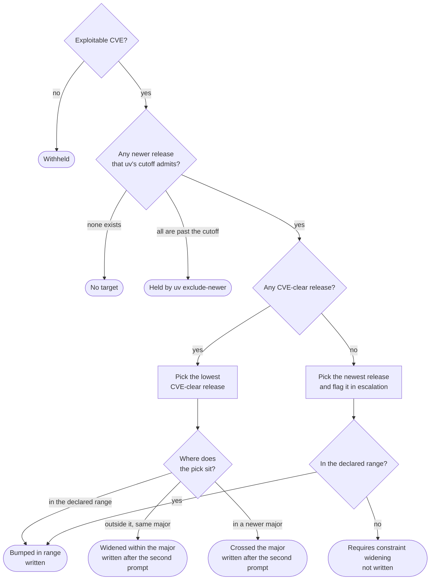
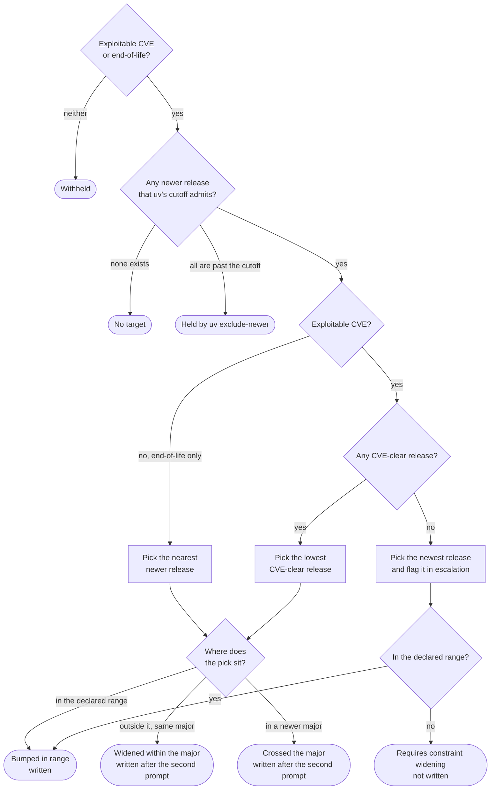
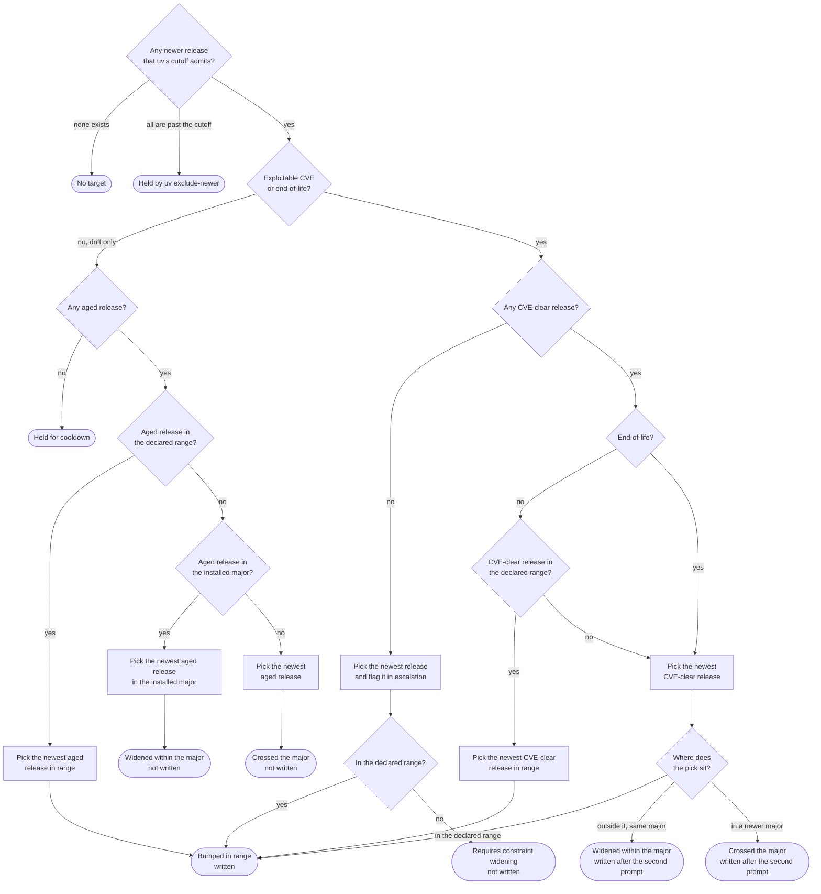
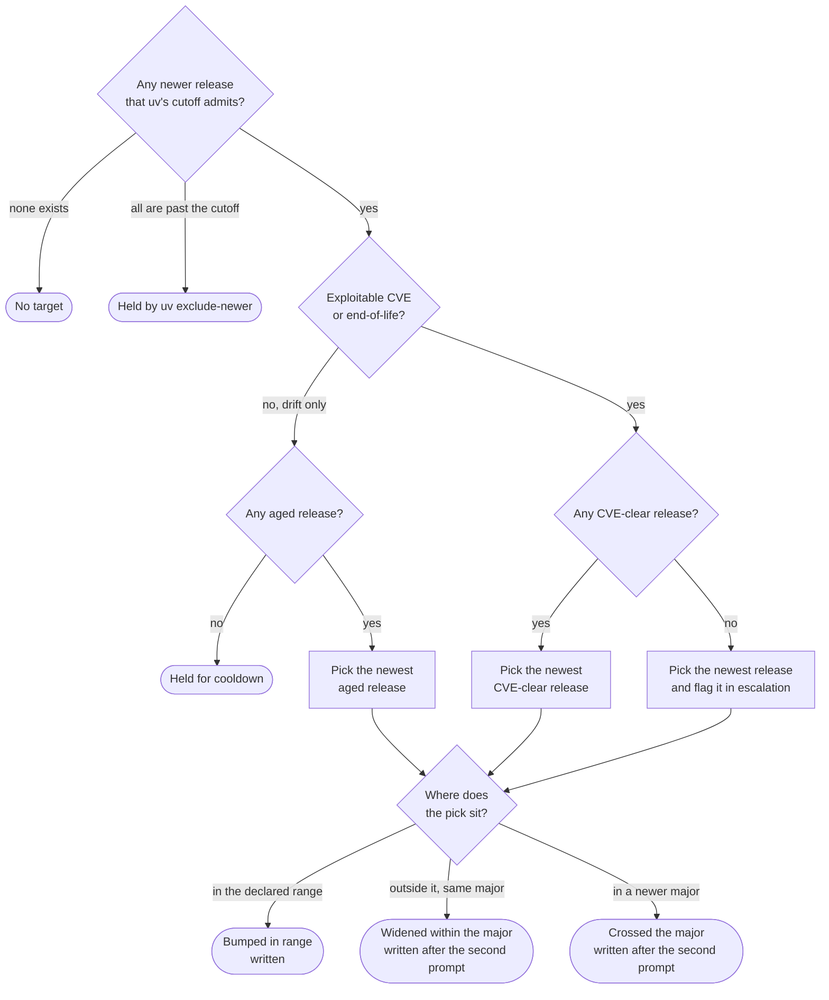

(target-selection)=
# How OSS IQ picks a target version

Part of [Explanation](../explanation/index.md).

**For each direct dependency, one function picks at most one version. The tier you run decides
which motives count, how far the pick can go, and whether it takes the nearest release or the
newest.**

That function is `select_target` in
[`strategy/targeting.py`](https://github.com/ossiq/ossiq/blob/main/src/ossiq/strategy/targeting.py).
It reads a prepared list of newer releases and returns one verdict, with no network access and no
version parsing. This page lists every verdict it returns at each tier.
[The update pyramid](update-pyramid.md) explains why the tiers differ.

## What the selector reads

| Input | What it holds |
|---|---|
| Motives | The reasons the package may move: `exploitable_cve`, `end_of_life` and `drift`. [Motives](motives.md) defines each one |
| Candidates | The releases newer than the installed version, oldest first. Each one carries its rung, its age, and whether an exploitable CVE still affects it |
| Cooldown | `--cooldown-period`, 7 days by default. Releases younger than the cooldown leave the candidates, unless the tier admits a CVE or end-of-life motive for the package |
| Release cutoff | uv's `exclude-newer` setting, when the project has one. Releases published after the cutoff leave the candidates whatever the motive, because uv refuses to install them |

Two words recur in the tables. A release is *CVE-clear* when none of the exploitable CVEs found
for the installed version affects it. A release is *aged* when it is at least as old as the
cooldown; a release with no publish date counts as aged.

The rung says where a release sits relative to the range your manifest declares:

| Rung | The release is |
|---|---|
| `in_range` | inside the declared range |
| `in_major` | outside the declared range, with the same major version as the installed one |
| `latest` | outside the declared range, in a newer major version |

Two details follow from these definitions:

- The selector compares rungs, not version numbers. If the declared range already admits the next
  major (`>=2.0.0`), a release in that major is `in_range`. Every tier that moves the package can
  take it without widening anything.
- All `0.x` releases share major version 0, so a move from `0.0.8` to `0.2.4` is `in_major`.

## The outcomes

The tier tables use six outcomes:

| Outcome | What it means | How it shows |
|---|---|---|
| **Withheld** | The tier admits none of the package's motives | `strategy.withheld_reason` names the lowest tier that moves the package |
| **No target** | The tier admits a motive, but no newer release is left to take | `recommended_version` is empty and `strategy.withheld_reason` is unset |
| **Held** | Newer releases exist, and every one of them is too new | `plan` lists the package under *Held for cooldown* or *Held by uv exclude-newer* |
| **Bumped in range** | The pick satisfies the declared range | `recommended_from_rung` is `in_range` |
| **Widened within the major** | The pick is outside the declared range and keeps the installed major version | `recommended_from_rung` is `in_major`, and `requires_constraint_widening` is true |
| **Crossed the major** | The pick is outside the declared range, in a newer major version | `recommended_from_rung` is `latest`, and `requires_constraint_widening` is true |

`apply` always writes a pick inside the declared range. It writes a pick outside the range in two
cases. Either the tier is `latest` or `cutting-edge`, or a CVE or end-of-life motive carried the
pick there (`strategy.widening_authorized`). Both times, `apply` asks for a second confirmation
first, which `--yes` skips. See [The two prompts](the-cycle.md#the-two-prompts).

In every other case, `plan` lists the pick under *Requires constraint widening* and `apply` leaves
the package alone.

(target-selection-security)=
## `security`: the lowest release that clears the CVE

`security` moves a package only for an exploitable CVE, and takes the lowest CVE-clear release
wherever it sits. The CVE outranks the cooldown, so this tier never holds a package for cooldown.

| The package has | Newer releases | Pick | Result |
|---|---|---|---|
| No exploitable CVE | any | none | **Withheld.** The reason names `deprecation` if the package is end-of-life, otherwise `standard` |
| An exploitable CVE | the lowest CVE-clear release is in the declared range | that release | **Bumped in range**, written |
| An exploitable CVE | the lowest CVE-clear release is outside the range, in the installed major | that release | **Widened within the major**, written after the second prompt |
| An exploitable CVE | the lowest CVE-clear release is in a newer major | that release | **Crossed the major**, written after the second prompt |
| An exploitable CVE | every release is still affected | the newest release | Flagged in `strategy.escalation`. Written if it is in range, otherwise listed under *Requires constraint widening* |
| An exploitable CVE | all published after uv's cutoff | none | **Held** |
| An exploitable CVE | none | none | **No target** |

The same decisions as a flowchart:

(target-selection-deprecation)=
## `deprecation`: also the next release of an end-of-life package

`deprecation` does what `security` does, and also moves an end-of-life package to its nearest
newer release. The selector treats any newer release as resolving an end-of-life motive, so the
pick is the smallest step off the installed version. It does not make the package maintained.
Both motives outrank the cooldown.

| The package has | Newer releases | Pick | Result |
|---|---|---|---|
| No exploitable CVE and no end-of-life motive | any | none | **Withheld.** The reason names `standard` |
| An exploitable CVE, end-of-life or not | any | as at `security` | The same result as in [the `security` table](#target-selection-security) |
| An end-of-life motive, no exploitable CVE | the nearest one is in the declared range | that release | **Bumped in range**, written |
| An end-of-life motive, no exploitable CVE | the nearest one is outside the range, in the installed major | that release | **Widened within the major**, written after the second prompt |
| An end-of-life motive, no exploitable CVE | the nearest one is in a newer major | that release | **Crossed the major**, written after the second prompt |
| An end-of-life motive, no exploitable CVE | all published after uv's cutoff | none | **Held** |
| An end-of-life motive, no exploitable CVE | none | none | **No target** |

The same decisions as a flowchart:

(target-selection-standard)=
## `standard`: the newest release the declared range admits

`standard` admits plain drift, so it never withholds a package. It takes the newest release in
the declared range. It leaves the range in three cases: a CVE the range cannot fix, an
end-of-life package, or a range that admits nothing newer.

| The package has | Newer releases | Pick | Result |
|---|---|---|---|
| Drift only | an aged release in the declared range | the newest aged release in range | **Bumped in range**, written |
| Drift only | no aged release in range, one in the installed major | the newest aged release in the installed major | **Widened within the major**, not written: *Requires constraint widening* |
| Drift only | aged releases only in a newer major | the newest aged release | **Crossed the major**, not written: *Requires constraint widening* |
| Drift only | all younger than the cooldown | none | **Held** |
| An exploitable CVE, no end-of-life motive | a CVE-clear release in the declared range | the newest CVE-clear release in range | **Bumped in range**, written |
| An exploitable CVE, no end-of-life motive | CVE-clear releases only outside the range | the newest CVE-clear release | **Widened within the major** or **crossed the major**, written after the second prompt |
| An end-of-life motive | a CVE-clear release anywhere | the newest CVE-clear release, even when the range holds one | **Bumped in range**, written. Outside the range: written after the second prompt |
| An exploitable CVE | every release is still affected | the newest release | Flagged in `strategy.escalation`. Written if it is in range, otherwise listed under *Requires constraint widening* |
| Any motive | all published after uv's cutoff | none | **Held** |
| Any motive | none | none | **No target** |

Two rows deserve a second look:

- **A CVE with no fix in range takes the newest CVE-clear release, not the nearest.** The
  `testdata/regression/update-strategies/npm` fixture installs `minimist` 0.0.8 and declares
  `~0.0.8`, a range with no fix. `security` picks 0.2.4, and `standard` picks 1.2.8.
- **`standard` reports a drift-only pick outside the range, and `apply` does not write it.**
  `--rewrite-versions` lifts that hold for an exact `==x.y.z` pin, because the flag exists to
  rewrite pins.

The same decisions as a flowchart:

(target-selection-latest)=
## `latest` and `cutting-edge`: the newest release anywhere

`latest` and `cutting-edge` take the newest release on the whole ladder, and `apply` writes it.
Neither tier withholds a package. The selector applies the same rules to both tiers.
`cutting-edge` differs in one input: prereleases are among the candidates.

| The package has | Newer releases | Pick | Result |
|---|---|---|---|
| Drift only | at least one aged release | the newest aged release | **Bumped in range**, written. Outside the range: **widened within the major** or **crossed the major**, written after the second prompt |
| Drift only | all younger than the cooldown | none | **Held** |
| An exploitable CVE or an end-of-life motive | a CVE-clear release anywhere | the newest CVE-clear release, aged or not | The same results as for drift |
| An exploitable CVE | every release is still affected | the newest release | Flagged in `strategy.escalation`, and written all the same, because the tier reaches that far |
| Any motive | all published after uv's cutoff | none | **Held** |
| Any motive | none | none | **No target** |

The same decisions as a flowchart:

## What the selector does not decide

The selector answers one question for one package. Four decisions sit outside it:

- **Which releases are candidates.** Compatibility checks run first and can remove a release.
  They cover the runtime a release supports ([Engine constraints](engine-constraints.md)),
  ESM-only releases for a CommonJS project
  ([The module-system line](update-pyramid.md#the-module-system-line)), and releases that break a
  transitive dependency. `rejected_candidates` names the newest release they removed at each rung.
- **npm peers.** After every package has a pick, OSS IQ sends back any pick whose peer ranges
  clash with another package's final version. The selector then runs again without that release.
  See *Held by peer dependencies* in the [catalogue](catalogue.md#the-non-recommendations).
- **Transitive dependencies.** The solver picks their versions. The selector runs for direct
  dependencies only.
- **Forced versions.** `--override pkg==version` sets the version and skips the selector.
  `--strategy-override pkg=tier` keeps the selector and runs it for that package at another tier.
